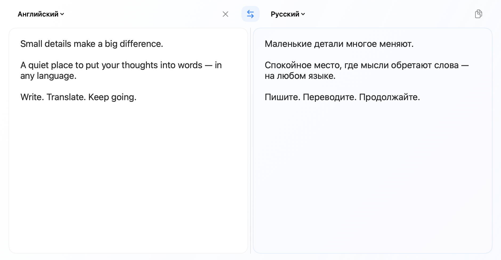

# Simple Translator

Нативный переводчик для macOS. Вставьте текст слева — справа появится перевод. Щёлкните слово в переводе, чтобы выбрать другую формулировку с учётом контекста и грамматики.



**[Скачать для macOS 14 и новее](https://github.com/dennech/simple-translator/releases/latest)** · [Быстрый старт](#быстрый-старт) · [Какую модель выбрать](#какую-модель-выбрать)

Выберите один из **20 сервисов перевода** и подключите свой API-ключ. Ключ хранится в системной Связке ключей macOS. Для подсказок по словам доступны **14 сервисов с языковыми моделями**. Попробовать перевод короткой общедоступной фразы без ключа можно через MyMemory.

## Скачать приложение

На странице выпуска скачайте ZIP с пометкой **macOS-universal**, распакуйте его и перенесите **Simple Translator.app** в «Программы». Один архив подходит для Apple Silicon и Intel. Рядом с ним опубликована контрольная сумма SHA-256.

Сборка пока имеет локальную подпись, **без сертификата Developer ID и проверки Apple (notarization)**. При первом запуске скачанного файла macOS может его заблокировать. Если вы доверяете этому выпуску, после попытки открыть приложение перейдите в **Системные настройки → Конфиденциальность и безопасность → Всё равно открыть**. [Официальное объяснение Apple](https://support.apple.com/102445).

## Возможности

- Автоматический перевод после короткой паузы во вводе; результат появляется постепенно.
- При редактировании старый перевод остаётся видимым. Новые абзацы дописываются справа; изменение существующей фразы обновляет результат после завершения перевода.
- Автоматическое направление: русский → английский, остальные языки → русский.
- Ручной выбор языков и кнопка смены направления.
- Два поля с прокруткой, изменяемый размер окна и ширина полей.
- Щёлкните слово в готовом переводе. Под ним появятся варианты по смыслу. Замена учитывает артикль и согласование соседних слов.
- Копирование перевода, светлая и тёмная темы, настройка размера текста.
- Мягкое изменение фона справа и три плавно пульсирующие точки во время перевода. Учитывается системное «Уменьшение движения».
- Длинные тексты переводятся частями, с сохранением абзацев.
- Выбор основного сервиса и отдельной модели для каждого сервиса.
- Актуальный список моделей OpenRouter с ценами и фильтром **«Только бесплатные»**.
- Справочник бесплатных API и локальных вариантов в настройках, с лимитами и ссылками на условия.

## Как подобрать другое слово

Щёлкните по слову в правом поле. При наведении на вариант подсветится весь фрагмент, который он заменит. Например, замена `an apartment → a flat` меняет артикль, а «тихое место → тихий уголок» — род прилагательного. Нажмите на вариант, чтобы применить замену в этом месте. При добавлении нового абзаца выбранная формулировка сохранится.

**Если переводите через DeepL.** В списке «Варианты слов» DeepL отсутствует, поскольку его API выдаёт готовый перевод без списка замен из фирменного приложения. Чтобы переводить через DeepL, а слова подбирать через Gemini, сначала сохраните ключ и модель Gemini. Затем выберите DeepL основным сервисом, а в **Настройки → Варианты слов → Подбирать через** укажите Gemini. [Документация DeepL API](https://developers.deepl.com/api-reference/translate/request-translation).

В режиме **«Автоматически»** подсказки подбирает основная языковая модель. Для DeepL и других специализированных переводчиков приложение пробует Apple Intelligence на совместимом Mac с macOS 26 или новее. Если локальная модель или язык недоступны, сервис можно выбрать прямо под словом. Облачной модели при щелчке отправляются слово и до 240 символов перевода с каждой стороны в пределах строки. Такой запрос расходует квоту выбранного сервиса.

## Быстрый старт

1. Откройте приложение и нажмите **⚙︎** или **⌘,**.
2. Выберите сервис. Для MyMemory ключ не требуется; для остальных нужны свои данные доступа.
3. Получите ключ по ссылке **«Получить ключ»**, вставьте его в защищённое поле и нажмите **«Сохранить»**. Если у сервиса есть дополнительные параметры, заполните их и нажмите **«Применить параметры»**.
4. Выберите модель из списка. Можно также вставить её идентификатор вручную и нажать **«Применить»**.
5. Нажмите **«Проверить перевод»**. При успешном подключении появится короткий перевод.
6. Закройте настройки и вставьте свой текст в левое поле.

Приложение само по себе не продаёт подписку. Оплату, бесплатную квоту и ограничения определяет выбранный API. Проверка подключения тоже является небольшим API-запросом.

## Подключения

**[Инструкция для всех 20 сервисов](docs/connections.md)** описывает необходимые ключи, регионы и параметры.

- Языковые модели: OpenAI, OpenRouter, Gemini, Groq, Cerebras, Fireworks, NVIDIA NIM, Mistral, Hugging Face, Together, SambaNova, SiliconFlow, GigaChat и Cloudflare Workers AI.
- Специализированный перевод: DeepL, Azure Translator, Google Cloud Translation, Amazon Translate, Yandex Translate и MyMemory.

У новых языковых API модель выбирается вручную: приложение не назначает платную модель автоматически. Новые подключения отмечены в настройках и проверены на тестовых ответах; реальную работу конкретного аккаунта нужно проверить кнопкой **«Проверить перевод»**. Локальный подбор слов через Apple Intelligence встроен. Для перевода всего текста приложение использует выбранный облачный сервис.

## Какую модель выбрать

Для повседневного перевода **русский ↔ английский** начните с **Gemini Flash-Lite**, если в вашем регионе доступен бесплатный уровень Google. Если у вас уже есть ключ OpenRouter, начните с **Gemma 4 31B** с суффиксом `:free`. Для недорогого платного перевода и подсказок через OpenAI подойдёт **GPT-6 Luna**. Выберите сервис в настройках и вставьте идентификатор из таблицы в поле **«Идентификатор модели»**.

Тарифы и идентификаторы проверены **18 ноября 2026 года**. В платных строках указаны доллары США за миллион входных и миллион выходных токенов соответственно. Токен — фрагмент текста. Выбор основан на тарифах и возможностях API. Сравнительный тест качества RU↔EN для этих моделей не проводился.

| Когда выбрать | Сервис и идентификатор модели | Стоимость и условия |
| --- | --- | --- |
| Перевод и подбор слов на бесплатном уровне Google | **Gemini API** · `gemini-3.5-flash-lite` | В пределах бесплатной квоты вход и выход стоят $0. На платном плане — **$0,30 / $2,50**, включая токены рассуждения в выходе. Бесплатные запросы могут использоваться для улучшения продуктов Google. [Тариф Google](https://ai.google.dev/gemini-api/docs/pricing#gemini-3.5-flash-lite) · [Доступные страны](https://ai.google.dev/gemini-api/docs/available-regions) |
| Бесплатно с ключом OpenRouter | **OpenRouter** · `google/gemma-4-31b-it:free` | Нулевая цена входа и выхода. Без покупки кредитов обычно до **20 запросов в минуту и 50 в сутки**. При нагрузке возможна очередь или ошибка 429. [Карточка Gemma](https://openrouter.ai/google/gemma-4-31b-it:free) · [Лимиты](https://openrouter.ai/docs/api_reference/limits) |
| Ещё один бесплатный вариант для перевода и подсказок | **Groq** · `qwen/qwen3.8-27b` | Для Free опубликованы **30 запросов в минуту и 1 000 в сутки**. Есть также пределы по токенам. Действующую квоту организации показывает кабинет Groq. [Лимиты Groq](https://console.groq.com/docs/rate-limits) |
| Недорогая модель с оплатой по объёму | **OpenAI** · `gpt-6-luna` | Стандартный тариф **$0,10 / $0,50**. Например, 100 тыс. входных и 100 тыс. оплачиваемых выходных токенов стоят около **$0,06**. [Карточка GPT-6 Luna](https://developers.openai.com/api/docs/models/gpt-6-luna) |
| Gemma через тот же ключ после исчерпания бесплатной квоты | **OpenRouter** · `google/gemma-4-31b-it` | При проверке каталог показывал **от $0,20 / $0,40**. Выберите платный вариант вручную и проверьте цену доступного поставщика. [Цены Gemma](https://openrouter.ai/google/gemma-4-31b-it) |

В версии 1.3.0 для OpenAI по умолчанию указан `gpt-4.1-mini`. Сейчас OpenAI помечает эту модель как устаревающую. При новом подключении модель можно сменить вручную. Для OpenRouter в окне выбора есть фильтр **«Только бесплатные»**. Политика обработки данных приложения может ограничить доступные маршруты. [Статус GPT-4.1 mini](https://developers.openai.com/api/docs/models/gpt-4.1-mini).

Если нужен только готовый перевод, есть и специализированные API. Например, **DeepL API Developer** предоставляет разовый объём в 1 млн знаков, а у **Azure Translator F0** квота возобновляется ежемесячно и составляет 2 млн знаков. [Планы DeepL](https://support.deepl.com/hc/en-us/articles/360021200939-DeepL-API-plans) · [Тариф Azure](https://azure.microsoft.com/en-us/pricing/details/translator/) · [Справочник бесплатных вариантов](docs/free-translation-options.md).

## Безопасность и приватность

**Ваш ключ хранится локально в системной Связке ключей macOS.** Он не встраивается в приложение и не записывается в исходники, обычные настройки, историю, Git или iCloud. Сохранённый ключ можно заменить или удалить в настройках.

Открытие настроек проверяет только наличие записи, без чтения ключа и без запроса пароля. Списки OpenRouter и DeepL доступны без ключа; OpenAI и Gemini загружаются по кнопке пользователя.

После разрешённого чтения копия ключа находится только в оперативной памяти до закрытия приложения, замены или удаления ключа. Поэтому повторные переводы не обращаются к Связке ключей заново. macOS может показать запрос доступа при первом запуске новой сборки. **«Разрешить»** действует на одно чтение, **«Разрешать всегда»** сохраняет доверие к этой сборке. У локально подписанных обновлений доверие может потребоваться заново; для стабильного доверия между выпусками нужна постоянная подпись разработчика. [Доступ к Связке ключей](https://support.apple.com/guide/keychain-access/kyca1243/mac), [подпись и права приложения](https://developer.apple.com/library/archive/technotes/tn2206/).

При переводе ключ передаётся выбранному официальному API по HTTPS для авторизации. Это необходимо для работы API. Сам текст также отправляется выбранному сервису; при использовании OpenRouter — OpenRouter и поставщику модели. Сервис и модель следует выбирать с учётом правил обработки данных.

Приложение не сохраняет историю переводов и не использует аналитику. Временный кэш находится в памяти и очищается крестиком или при завершении приложения. Сетевой кэш на диске и cookies выключены, переадресации запросов запрещены. Дополнительные секреты AWS также хранятся в Связке ключей; временный OAuth-токен GigaChat — только в памяти. Регион, Account ID и scope являются параметрами подключения и сохраняются в настройках на этом Mac.

Для OpenRouter запрещена маршрутизация к поставщикам, использующим данные для обучения; у бесплатного уровня Gemini условия использования данных могут отличаться. Для OpenAI выключено сохранение ответов через параметр `store=false`; правила служебного хранения данных самого сервиса всё равно действуют.

## Если перевод не появился

| Сообщение или ситуация | Что сделать |
| --- | --- |
| Ключ отклонён | Проверьте, что ключ относится к выбранному сервису, активен и имеет доступ к модели. |
| Недостаточно средств | Проверьте баланс и тариф в кабинете сервиса либо выберите доступный бесплатный вариант. |
| Достигнут лимит | Подождите или выберите другую модель. У бесплатных API лимиты обычно строже. |
| Модель недоступна | Обновите список моделей и выберите доступную. |
| Нет связи | Проверьте интернет и доступность API в вашем регионе. |
| Перевод оборвался | Нажмите «Повторить». Незавершённый ответ не отмечается как готовый. |

Большой текст обычно разбивается на части до 6000 символов; у MyMemory — до 500 байт и одного абзаца, у Amazon Translate — до 10 000 байт. Абзацы сохраняются, но контекст между частями ограничен. Имена, цифры и важные термины стоит проверять отдельно.

При дописывании нового абзаца отправляется только добавленный текст: предыдущий перевод сохраняется. Связь с предыдущими абзацами при таком переводе ограничена. Если нужно заново перевести весь текст в едином контексте, очистите поля и вставьте текст повторно. При изменении существующего предложения приложение само переводит текст заново, сохраняя прежний результат на экране до окончания запроса.

## Горячие клавиши

| Сочетание | Действие |
| --- | --- |
| ⌘, | Настройки |
| ⌘⇧S | Поменять языки |
| ⌘⇧C | Скопировать готовый перевод |
| ⌘↵ | Перевести сразу / повторить |
| ⌘⌫ | Очистить текст и временный кэш |

## Сборка из исходников

Нужны **macOS 14 или новее**, Swift 6 и инструменты Xcode. Сторонние библиотеки и отдельный сервер не требуются.

```sh
./script/build_and_run.sh              # собрать и открыть
./script/build_and_run.sh --build-only # только собрать
./script/package_release.sh           # универсальная сборка и ZIP
swift test                            # проверки
```

Готовое приложение появится в `dist/Simple Translator.app`; архив и контрольная сумма — в `dist/releases/`. Иконка воспроизводится из `script/generate_icon.swift`. GitHub Actions запускает проверки и создаёт архив при изменениях в `main`, тегах версий и вручную. Готовые выпуски для обычного скачивания публикуются в разделе Releases.

Технические проверки описаны в [docs/validation.md](docs/validation.md). Личных ключей в репозитории нет: каждый пользователь подключает свои.

## Участники

**[dennech](https://github.com/dennech)** — автор проекта: идея, требования и проверка приложения.

**[OpenAI Codex](https://github.com/apps/chatgpt-codex-connector)** — помощь в реализации, проверках и документации. В истории коммитов указан как соавтор.
